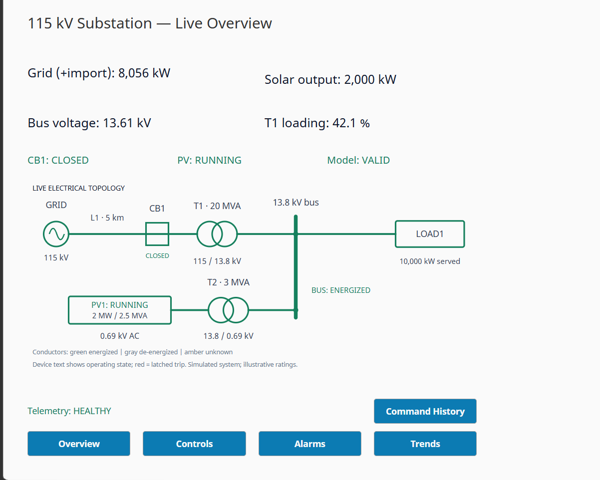
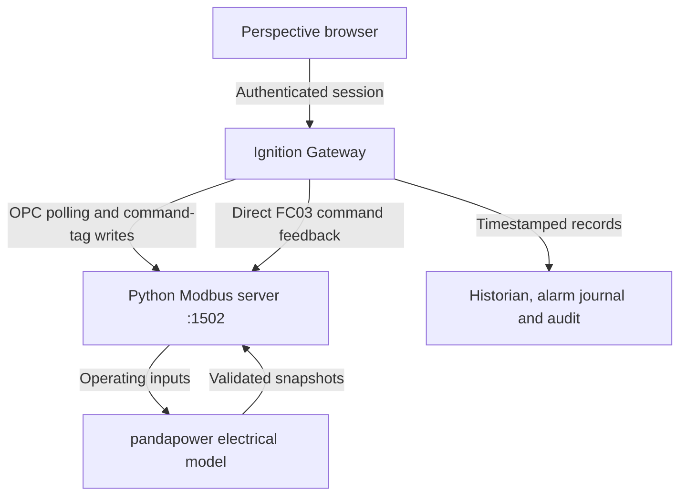

# 115 kV Substation SCADA & Solar Monitoring Simulator

An educational substation simulator that connects a balanced AC power-flow model to an Ignition operator interface over Modbus TCP. It models a 115 kV supply, a 20 MVA transformer, a 13.8 kV load bus, and a 2 MW solar plant, with interlocked controls, alarms, historical trends, command auditing, and telemetry-health handling.

**Author:** Arnav Jitendra Nevgi



## What is implemented

| Area | Implementation |
|---|---|
| Electrical model | pandapower balanced three-phase AC power flow; line, CB1, two transformers, constant-P/Q load, and a static grid-following solar model |
| Controls | CB1 open/close, PV enable/stop, separate trip reset, local/remote and fault interlocks |
| Training protection | Grid-only three-phase fault calculation, independent impedance reference, illustrative overcurrent pickup/delay, and breaker movement delay |
| Device interface | PyModbus server at `127.0.0.1:1502`, unit 1; 41 mapped holding-register/discrete-input points |
| HMI | Six Perspective views; live single-line states, analog values, alarm and command histories, and Grid/PV trends |
| Data health | Quality checks, changing-heartbeat detection, a monitor watchdog, model validity, and explicit UNKNOWN/unavailable states |
| History | 12 history-enabled tags, 11 alarm definitions, a database alarm journal, and a Local command-audit profile |
| Access | Viewer session access and Operator permissions on all nine equipment/scenario script actions |
| Evidence | Eight live-runtime screenshots and a decoded Modbus STOP/START capture with packet references |

The model uses illustrative equipment parameters. The solar model is a static P/Q injection with operating rules; the protection sequence uses software timing. See [scope and limitations](docs/scope-and-limitations.md).

## Observed operating results

| State | PV output | Grid import | Bus voltage | T1 loading |
|---|---:|---:|---:|---:|
| Normal | 2,000 kW | 8,056 kW | 13.61 kV | 42.1% |
| PV stopped, grid-fed bus | 0 kW | 10,053 kW | 13.60 kV | 51.9% |

Opening CB1 leaves the upstream grid conductor energized, makes the downstream bus de-energized, and latches the PV trip. Reset, breaker close, and PV restart are separate operations. During a communication outage, the Overview replaces retained measurements with unavailable values and shows amber/UNKNOWN states. Fresh valid telemetry restores the display.

| Evidence | Result |
|---|---|
| [Live Overview acceptance](evidence/live-overview/README.md) | Normal, PV stop/start, CB1 opening/restoration, audit entries, communication loss and recovery reviewed from eight screenshots |
| [Modbus command-cycle report](evidence/modbus/README.md) | STOP sequence 1 and START sequence 2 both receive matching APPLIED feedback; power changes 2,000 → 0 → 2,000 kW |
| [Verification report](docs/verification.md) | Electrical, control/TCP, health, audit, packet-analysis and export-consistency checks, with each test scope identified |

## Run the simulator

From the repository root in Windows PowerShell, with Python 3.14 installed:

```powershell
py -3.14 -m venv .venv
.\.venv\Scripts\python.exe -m pip install -r requirements.txt
.\.venv\Scripts\python.exe .\simulator\phase4_powerflow.py --verify
.\.venv\Scripts\python.exe .\simulator\phase7_modbus_server.py
```

Keep the server terminal open. A read-only client check from another terminal is:

```powershell
.\.venv\Scripts\python.exe .\simulator\phase7_client.py
```

The application dependencies are pinned to `pandapower==3.5.6` and `pymodbus==3.16.1`. The live Windows project used Python 3.14.3 and Ignition Maker 8.3.10. The packaged source was also checked on Linux with Python 3.12.14. Transitive Python packages are resolved by pip.

Ignition requires the [Gateway setup](docs/setup.md). The current native project ZIP and the separate tag export are included under `ignition/`.

## Architecture



The Gateway's command helper stages the command code, commits a new sequence, and reads status/reason/acknowledged sequence together. A Modbus write echo and an equipment-command outcome are handled separately. The server owns equipment state, interlocks, and protection behavior.

Read [architecture](docs/architecture.md), [command protocol](docs/command-protocol.md), and [security and data health](docs/security-and-health.md) for the implementation details.

## Repository guide

| Path | Contents |
|---|---|
| `simulator/` | Electrical model, Modbus server/clients, control engine, fault calculation, configuration and tests |
| `ignition/SubstationSCADA_project.zip` | Unchanged native export from 20 October 2026 |
| `ignition/project/` | Exact unpacked resources for review and version comparison |
| `ignition/Substation_tags.json` | Separate 74-tag snapshot supplied on 19 October 2026 |
| `ignition/scripts/` | Readable copies of the two current exported Project Library modules |
| `evidence/` | Runtime screenshots, original packet capture, decoded data and reference checks |
| `validation/` | Fresh packaged-source validation reports |
| `tools/check_project.py` | Read-only static checks of resources, tag paths, navigation and permissions |
| `docs/` | Setup, design, verification, scope and source provenance |

Project exports do not include Gateway users, device connections, historian storage or existing alarm/audit rows. Those dependencies are listed in the setup guide. File names such as `phase7_modbus_server.py` retain the development-stage names used in the verified source; this is the normal combined server.

For publication instructions and suggested repository metadata, see [publish to GitHub](docs/publish-github.md).

A [GitHub Actions workflow](.github/workflows/verify.yml) runs the isolated source/packet/static checks on pushes and pull requests. Check the [Actions page](https://github.com/ArnavNevgi/substation-scada-simulator/actions) for hosted run results. The validation reports included here record the local packaging checks.
